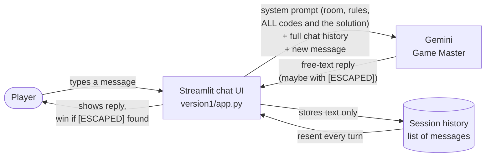
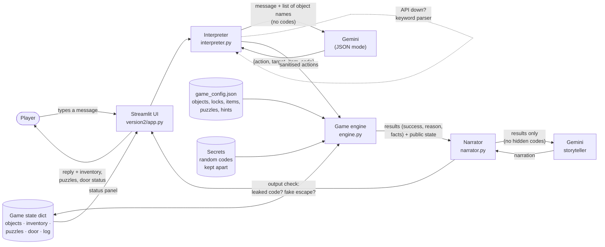

# System architecture

## Version 1 — the LLM is the game

| Component | Role |
|---|---|
| `version1/app.py` | Streamlit page: intro, instructions, chat, restart button. Declares a win when the reply contains `[ESCAPED]`. |
| `version1/game_master.py` | Holds the system prompt (room, puzzles, **solutions**, rules) and calls Gemini with the full history. |
| Session history | The only memory. It is plain text, so it also contains whatever the player claims. |

**Who decides whether an action succeeds?** The LLM, alone.

---

## Version 2 — Python decides, the LLM describes

| Component | Role |
|---|---|
| `version2/app.py` | Streamlit page. Sidebar shows door status, solved puzzles and inventory straight from the engine. Optional "show what the engine decided" view. |
| `version2/interpreter.py` | Turns the message into at most 3 structured actions using Gemini's JSON mode. Removes unknown verbs and any digits the player did not type. Falls back to a keyword parser. |
| `version2/engine.py` | The rules. Keeps the state dictionary, validates every action, unlocks things, moves items into the inventory, generates the codes for each game and checks invariants. |
| `version2/game_config.json` | The room as data: objects, aliases, locks, items, puzzle list and hints. |
| `version2/narrator.py` | Asks Gemini to describe the engine's result. Rejects replies that contain a protected code or claim the door opened. Falls back to the engine's own text. |
| `version2/pipeline.py` | One turn: interpreter → engine → narrator. |
| `version2/llm.py` | Small Gemini wrapper with one retry. |

**Who decides whether an action succeeds?** `engine.py`. The LLM can only suggest an action and describe the result.

### What each part is allowed to see

| | Player message | Object names | Game state | Codes not yet found | Can change the state |
|---|:-:|:-:|:-:|:-:|:-:|
| Version 1 — Gemini | ✅ | ✅ | (text history) | **✅ all of them** | **✅** |
| Version 2 — Interpreter LLM | ✅ | ✅ | ❌ | ❌ | ❌ |
| Version 2 — Engine (Python) | actions only | ✅ | ✅ | ✅ | ✅ |
| Version 2 — Narrator LLM | ✅ | ✅ | public part | ❌ | ❌ |
